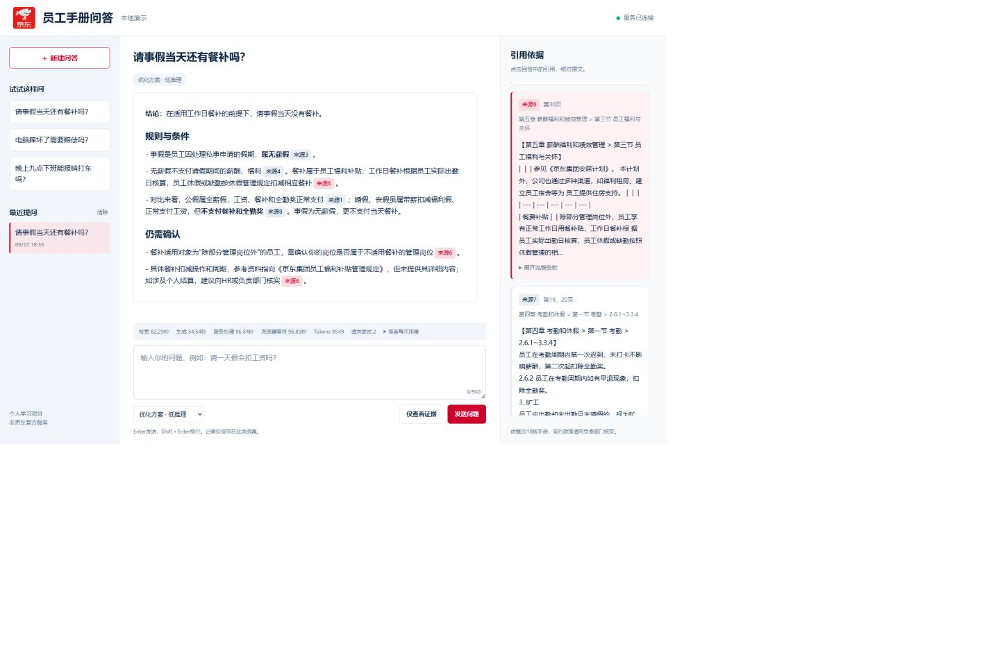
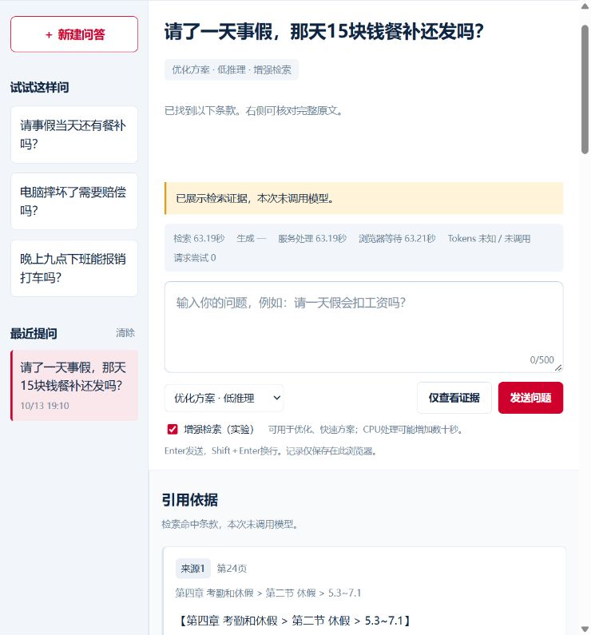

# 本地网页演示验证（2026-09-27）

## 实现与目的

FastAPI 同源提供静态页面和 JSON API，复用既有检索及生成函数。页面展示实际输入来源、页码、章节和完整条款，支持点击引用定位。这样可以在面试演示中观察证据链，而不是只看最终答案。Python 后端降低复用现有模型生态的工程成本；原生前端避免第一版引入构建工具。没有对 Java 后端或其他前端框架做速度对照。

请求独立收集用量，串行锁保护首次加载和共享索引；无效输入拒绝，忙碌返回409，生成失败保留证据。页面用文本节点呈现模型内容，API 密钥不进入前端。仅检索不调用生成模型。

## 实际运行

环境：Windows、本地 CPU、InternVL conda 环境、已存在的本地索引及模型缓存；生成使用既有配置接口。

| 验证 | 输入与方案 | 结果 |
|---|---|---|
| 真实生成 | 请事假当天还有餐补吗？；优化方案 low | 返回完整回答和8个输入来源，引用可定位对应条款 |
| 首次请求耗时 | 上述浏览器请求，含冷加载 | 检索62.29秒，生成34.54秒，服务96.84秒，浏览器等待96.89秒 |
| 真实生成用量 | 上述请求，界面每次用量统计 | 2次尝试，合计9549 tokens；包含截断后的重试 |
| 预热后仅检索 | 请了一天事假，那天15块钱餐补还发吗？ | 8个来源，检索0.284秒，客户端0.299秒；0次生成 |

预热请求原始 JSON 保存在 `evaluation/local_web_smoke_2026-09-27.json`。首次生成数据来自浏览器实际展示，截图见下方。这两个操作和问法不同，各只有一次，不能用来计算优化收益或代表P50/P95；也没有对网页版本重新做回答质量评测。需要性能基准时，应固定同一题集、区分冷启动与预热、重复运行并报告分位数。

## 验证范围

- 既有及新增 API 单元测试共23项通过：覆盖输入校验、上下文来源映射、用量、忙碌、失败保留证据、配置缺失及截断状态。
- 浏览器已实际检查历史恢复、引用定位、桌面布局和390像素窄屏布局；桌面检查时控制台无 error 日志。
- 服务仅监听127.0.0.1:8000。启动方式见 README；部署、并发扩容、多轮记忆和账户功能尚未实现。



## 可选增强检索接入（2026-10-13）

页面增加默认关闭的“增强检索（实验）”开关，适用于优化和快速方案。启用后，在相同候选池上独立计算完整 Guard 与 BGE 排序，以固定50%/50%名次融合后取8块，完整原文与来源传入既有上下文和生成流程。历史记录保留是否启用增强检索；读取旧记录时按关闭处理。处理中开关锁定，切换到原方案或复杂问题模式时自动关闭并禁用，以保留原有对照与Agent流程。

API示例（改为 `retrieval_only: false` 即进入既有生成阶段）：

```json
{"question":"请了一天事假，那天15块钱餐补还发吗？","profile":"quality","enhanced_retrieval":true,"retrieval_only":true}
```

响应包含 `enhanced_retrieval` 标记，页面将其显示在方案标签中。原方案或复杂问题模式同时要求增强检索时返回422；缺失本地重排模型或评分失败返回明确的 `retrieval_failed`，不会自动改用原排序或继续生成，随后可关闭开关重试。

接入验证：网页接口测试16项通过，完整回归90项通过，前端脚本语法检查通过。新增测试确认默认关闭保持原调用、quality/fast传入固定融合配置、融合片段按原顺序进入生成、仅检索不调用生成模型、失败释放请求锁并隐藏内部错误，以及不支持组合的请求校验。生成阶段通过测试替身核对参数传递，本次没有付费调用回答模型，不能据此称答案质量已经提升。

浏览器实际验证了初始关闭、忙时禁用开关、quality/fast可启用、切换baseline/agent自动关闭、页面刷新后默认关闭、历史记录恢复增强标记及390像素窄屏布局（无横向溢出）。真实本地模型检索“事假当天是否发餐补”，返回8块证据，三块必要证据位于第5/3/2位，与冻结实验D一致；关闭开关后恢复A的证据顺序。一次冷加载增强请求的检索耗时为63.19秒，随后普通预热请求为0.20秒，两次均0次生成。这是接入冒烟检查，两者加载状态不同，不能用于计算收益或代替P50/P95。记录见 `evaluation/web_fusion_smoke_2026-10-13.json`。



检索质量与CPU耗时仍以[固定题集四组实验](evaluation/guard_fusion_experiment_2026-10-13/ANALYSIS.md)为依据。网页开关只是使该能力可选进入问答流程，没有改变已验证的检索权重，也没有新增回答正确率或真实用户评测结果。
